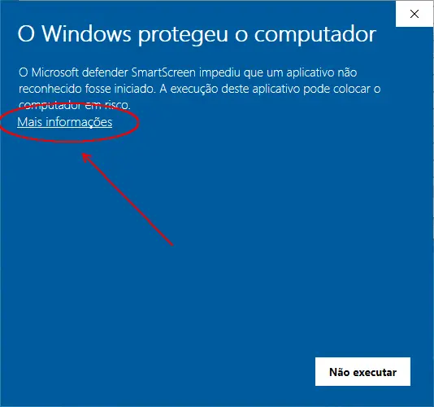
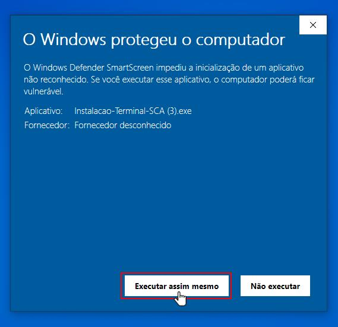

# SGE Diário

Acompanhe as pendências do diário escolar no SGE 3.0 — do seu diário e da escola inteira.

 

---

## Baixar

| Plataforma | Arquivo | Observação |
|---|---|---|
| Android | `SGE-Diario-2.9.0.apk` | Android 8.0 ou superior. |
| Windows | `SGE-Diario-Desktop-Setup-<versão>.exe` | Instalador para Windows x64. Entra no SGE sozinho e se atualiza. Veja o [guia do app Windows](desktop-next/README.md). |
| Canal de testes | [release `latest`](https://github.com/nabikendo/sge-diario-widget/releases/tag/latest) | Pré-versões automáticas. |

Todas as versões estão em [Releases](https://github.com/nabikendo/sge-diario-widget/releases).

---

## Como começar no Android

1. Instale o APK e abra o app.
2. Na aba **SGE Web**, entre com seu perfil no SGE 3.0.
3. Volte a **Meu diário** ou **Coordenação** e toque em atualizar.

O app lê o que o SGE mostra na sua sessão e monta o painel no aparelho. Não grava nada no SGE.

## Como começar no Windows

1. Baixe e instale o `SGE-Diario-Desktop-Setup-<versão>.exe` da [última release](https://github.com/nabikendo/sge-diario-widget/releases/latest).
2. Abra o app e clique em **Entrar no SGE**. O app reconhece sozinho se o perfil é Servidor (professor) ou Unidade escolar (coordenação).
3. Pronto: as pendências aparecem e o app se atualiza e avisa sozinho. Detalhes, privacidade e backup no Google Drive no [guia do app Windows](desktop-next/README.md).

### Passo a passo para instalar (para quem nunca instalou um programa fora da loja)

1. Abra a [página das versões](https://github.com/nabikendo/sge-diario-widget/releases/latest) e, na parte **Assets** (no fim da página), clique no arquivo que termina em `.exe` e começa com `SGE-Diario-Desktop-Setup`. O download começa sozinho.
2. Quando terminar, abra o arquivo baixado (na pasta **Downloads**, ou clicando nele no navegador).
3. O Windows pode mostrar uma tela azul com o título **"O Windows protegeu o computador"**. Isso é normal: acontece com qualquer programa novo que ainda não é conhecido pela Microsoft. O app não é um vírus; o código está aberto neste repositório.

   Clique em **Mais informações** (o texto sublinhado, abaixo da mensagem):

   

4. Vai aparecer o botão **Executar assim mesmo**. Clique nele:

   

   Nesta tela o "Fornecedor" aparece como *desconhecido* porque o instalador ainda não tem assinatura digital paga. Não use o botão "Não executar", ele cancela a instalação.
5. Siga o instalador até o fim e abra o **SGE Diário** pelo ícone na área de trabalho ou pelo menu Iniciar.

> As imagens acima são exemplos do aviso do Windows; o nome do arquivo na sua tela será `SGE-Diario-Desktop-Setup-…exe`.

O app antigo, que abria backups do Android, continua descrito no [guia anterior](desktop/README.md).

---

## Bimestre

Na tela inicial, escolha **Atual**, **1º**, **2º**, **3º**, **4º** ou **Todos**.

- **Atual** é o padrão: o bimestre em que estamos hoje, pelas datas do próprio SGE.
- **Todos** mostra o ano inteiro.
- Trocar o bimestre atualiza o painel sozinho. O cabeçalho mostra qual bimestre está aplicado.
- Conteúdos e Frequência consideram só o bimestre escolhido. Os demais módulos seguem o mesmo recorte do último sync.

---

## Categorias de turma

O app identifica a categoria pelo nome da turma:

| Nome | Categoria | Entra na verificação |
|---|---|---|
| `13.01/EM.MAT-ANL` (1 ou 2 dígitos) | Escolarização | Sim, por padrão |
| `115.09…` (3 dígitos) | Diversificada | Só se você ativar em Ajustes |
| `1111.01…` (4 dígitos) | AEE | Só se você ativar em Ajustes |

Para incluir diversificadas ou AEE, abra **Ajustes** e ative a categoria. O app busca e sincroniza essas turmas na hora.

---

## O que você vê

Cinco módulos por turma: **Conteúdos · Frequência · Plano de aula · Plano de curso · PEI**.

| Símbolo | Significado |
|---|---|
| `—` | Não verificado nesta consulta. |
| `*` | Cobertura parcial: pode haver dados faltando. |
| `0*` | Zero em consulta incompleta: não confirma que está em dia. |

Uma turma só aparece **em dia** quando os cinco módulos foram conferidos por completo e todos têm zero pendências.

---

## Recursos

- **Painel pessoal e coordenação:** cartões por turma, componente ou professor, com busca e filtros.
- **Coordenação por professor:** no grupo de um professor, sincronizar verifica só as disciplinas dele.
- **Hero Card:** total de pendências, barra de turmas em dia e botão de sincronizar.
- **Widgets:** seis opções para a tela inicial, com horário da última consulta, avisos de cobertura e atalhos por módulo.
- **Fila de coordenação:** veja o progresso, pause, retome depois de renovar a sessão e reprocesse as turmas que falharam.
- **Histórico:** compare consultas e veja pendências novas, resolvidas ou sem verificação.
- **Conferência semanal:** em Coordenação, selecione uma semana e um professor, revise o que o SGE retornou e confira a prévia do PDF ou do texto.
- **Relatórios:** texto para WhatsApp ou PDF para a coordenação, com o bimestre no cabeçalho.
- **Tablets:** painel lado a lado em telas largas.

---

## Android 17

Com o **Continuar em outro dispositivo** do sistema, um aparelho compatível pode abrir o mesmo painel ou semana em outro aparelho com o SGE Diário instalado. O app transfere apenas o recorte de navegação. Cada aparelho usa seus próprios dados locais, sessão do SGE e proteção da coordenação.

As consultas manuais exibem progresso no app. Se as notificações estiverem autorizadas e o Android aceitar a promoção, o progresso pode aparecer como atualização ao vivo.

## Privacidade

O painel consulta dados em modo somente leitura. O backup, em arquivo ou na pasta oculta do Google Drive, é feito por ação sua e pode conter informações escolares. Guarde o arquivo e os relatórios em local de acesso restrito. A janela oficial do SGE Web no Windows mantém sua própria sessão local.

---

## Limitações conhecidas

- Os resultados valem para o último sync. Depois de trocar o bimestre, o painel atualiza sozinho, mas leva alguns minutos.
- A conferência semanal usa as datas que o SGE retornou e os vínculos docentes locais. Confira o horário oficial e a adequação do conteúdo à matriz, ao plano e ao PEI nas fontes originais.
- Não é oficial nem tem vínculo com a Seduc-TO ou a Ponto iD.

---

## Como funciona a versão

Usamos três números no formato **MAIOR.MENOR.CORREÇÃO**. Em **2.5.15**, o **2** identifica a geração do app, o **5** a série de funcionalidades e o **15** a revisão dessa série.

| Próxima versão | Quando usar |
|---|---|
| `2.5.16` | Corrigir falhas mantendo a compatibilidade. |
| `2.6.0` | Adicionar um recurso compatível, como novos filtros no painel. |
| `3.0.0` | Fazer uma mudança que quebra compatibilidade, como trocar o formato de backup sem oferecer migração. |

O fluxo estável usa [release/versao.txt](release/versao.txt) ou a versão informada no disparo manual para compilar o APK e o EXE. O Android também usa um código interno de compilação para ordenar instalações. [Referência do versionamento semântico](https://semver.org/lang/pt-BR/).

## Licença

MIT. Consulte [LICENSE](LICENSE).

## Publicação na Google Play

O workflow **Release estável** gera o APK do GitHub e um AAB assinado para a loja. Ambos usam a mesma versão e o mesmo `versionCode` (número da execução do workflow). O AAB fica no artefato `android-play-estavel`, na execução em **Actions**.

1. No Play Console, cadastre o app `br.to.seduc.sgediariowidget` e configure o Play App Signing. Use como chave de upload a chave que já assina os builds do workflow, ou ajuste a assinatura antes de enviar. Se quiser que a Play atualize instalações do APK do GitHub, confirme que a **chave de assinatura do app** da Play corresponde à do APK já distribuído.
2. Envie o primeiro AAB pelo Play Console e conclua a configuração do app e os testes exigidos. Confirme que o app tem acesso à faixa de produção. Se já houver versões na Play, o próximo número de execução do workflow precisa superar o maior `versionCode` já enviado.
3. No Google Cloud, habilite a **Google Play Android Developer API** e crie uma conta de serviço. No Play Console, conceda a essa conta permissão de publicar em produção para este app. Salve o JSON da conta em **Settings → Secrets and variables → Actions → Secrets** como `PLAY_SERVICE_ACCOUNT_JSON`.
4. Em **Settings → Secrets and variables → Actions → Variables**, defina `PLAY_PUBLICAR_AUTOMATICAMENTE` como `true`. A partir daí, quando o workflow publicar um release estável no GitHub, ele enviará o AAB para produção. A disponibilidade na loja depende do processamento e da revisão do Google Play.

Se o GitHub Releases já estiver publicado e apenas o envio à Play falhar, corrija a configuração e use **Re-run failed jobs** na mesma execução, enquanto o artefato estiver disponível. Confira no Play Console se o envio anterior chegou antes de tentar novamente.
